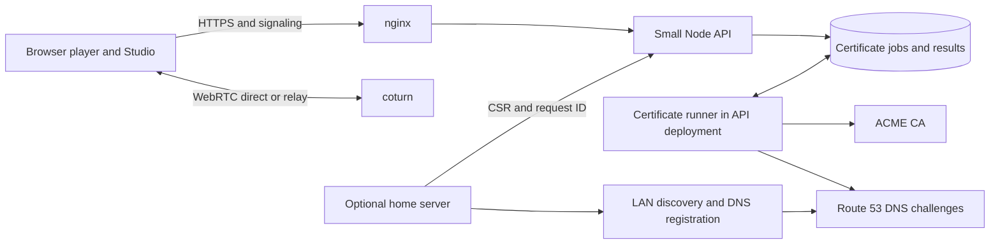

**Homegames launch readiness — October 17, 2026**

**Recommendation: hold the broad launch while closing the release gates below.** The browser-first product works through its basic play, private invite, editing, export, and import paths. Local input security, metadata/authoring, returning-user reliability, security/dependencies, and MIT/Squish 1.5.0 now have implementation checkpoints. The shared MIT packages are now published and pinned. The API, production certificate/discovery flow and a real cellular TURN session now pass acceptance. The remaining work is to finish release artifacts, validate supported devices and platforms, and complete longer relay/load checks. More games or features are not prerequisites for launch. Earlier checkpoints and findings below remain historical evidence, not statements that their original defects are all still open.

This review covers the current working trees, existing generated website, public website/API responses, local browser execution, and tests across Core, Common, Client, Squish, API, worker, Link, website, and native launcher. The working trees contain substantial pre-existing changes; these observations are a snapshot, not a certification of a tagged release. The original review made no production changes. Later authorized CloudFront/TURN networking changes and maintainer-run service deployments are recorded below. Public signaling and relay checks use disposable private invitations; security probes use bounded temporary allocations without the shared server secret.

The deployment clarification is **nginx → systemd Node API on EC2 running AL2023**. AL2 was a typo and is not a finding. The maintainer deployed the API and enabled its production certificate runner on October 18. The Mac Studio certificate worker is disconnected; staging issuance, production issuance, durable recovery and discovery acceptance are recorded below.

**Latest checkpoint: published Common and Docker acceptance — October 18, 2026.** Published Common **1.7.4** is installed and pinned in Core and the native launcher; all 39 published JavaScript files match the reviewed Common source. The native preview `selfhost-docker-review-20261018` passes startup, all 33 visible manifests/media and the complete certificate recovery browser flow. The real packaged Docker runner passes two-player input, save/restart, container cleanup, read-only runtime mounts, dropped capabilities, no-new-privileges, verified test-CA HTTPS/WSS and validation with networking disabled. Docker images now use the installed runtime contents, prepare from a downloaded app without sibling repositories, rebuild after runtime changes, and retry cleanly after Docker or build failures. Common passes 44 checks; Core passes 226; the focused Docker suites pass seven (four overlap Common); launcher units pass 50 with two opt-in artifact checks exercised separately. Signed/notarized **2.0.3** is prepared at `homegames/dist/release-2.0.3-lnsw76`, includes the requested Homegames app icon and remains unpublished. Both extracted ZIP and DMG apps pass quarantine/translocation launches on Apple Silicon; their checksums are recorded. The signed runtime also retains its original production certificate through a host restart and still resolves through Link. Windows/Linux/Intel Mac device acceptance remains open. [Current evidence and remaining gates](review-evidence/selfhost-2026-10-18/README.md).

**Previous checkpoint: self-host candidate and certificate recovery — October 18, 2026.** The unpublished `selfhost-single-https-review-20261018-b` candidate contains Client 0.2.1, Common 1.7.3, Squish 1.5.0, 33 visible games and four Node 24.22.0 runtimes. Apple Silicon native startup, all visible manifests/media, offline ZIP import and two local RTC peers pass. The actual bundle/supervisor also passes unavailable-service feedback, same-request retry after a lost response, HTTP-to-HTTPS restart, hot TLS renewal, public-IP-change preparation, discovery gating and a host-controlled restart against a disposable test CA. Focused Core checks pass 251/251; host/CSR boundaries 9/9; launcher units 50 pass with two opt-in artifact checks skipped and native artifact smoke run separately. API checks cover real MongoDB, a 16-second DNS cleanup delay and reused valid authorization without another challenge. **Real Let's Encrypt staging passed both server keys, duplicate submission, cleanup, ownership and API-restart retrieval.** The old Mac Studio worker is disconnected, the empty queue is preserved, two legacy certificate records are privately backed up, and the live API runs Node 24.22.0 with a ready production issuer and separate account key. One controlled production request through the native app passes trusted HTTPS, local restart and live discovery; the maintainer confirms exactly one completed attempt and no pending cleanup. Link now runs Node 24 and starts on reboot. Its stricter validation exposed a Core environment-port serialization bug; that and aggressive reconnects are fixed, with four client regressions, nine Link server checks and repeated native/certificate browser acceptance passing. After a production API restart, the original certificate was retrieved unchanged; the maintainer’s phone also reached the dashboard on Wi-Fi. Extended physical-device play, renewal acceptance, physical handoff of the accepted single-HTTPS-computer limit, Docker and final signed/platform acceptance remain open. [Evidence and current gates](review-evidence/selfhost-2026-10-18/README.md).

**Previous checkpoint: live TURN and 404 — October 18, 2026.** CloudFront serves the branded `/404.html` with HTTP 404. Coturn 4.18.0 is running on the existing AL2023 API instance; the API issues temporary credentials. Live Chrome has successful forced UDP/TCP/TLS runs with selected relay candidates at both ends, input, audio, sustained frames, guest rejoin and host closure. Live authentication/private-address checks caught coturn's implicit own-private-IP allow rule; a separate UID-scoped nftables guard now blocks non-relay self destinations, with real Linux packet checks supplied by the maintainer. Post-guard UDP/TLS passed; one TCP disconnect was observed during the configuration work, followed by a passing 30-second TCP repeat. The maintainer also reports a successful laptop-to-cellular House Band join/control/audio/rejoin check. **Long-session/load testing and the broader device/network matrix remain open.** Existing API/TURN TLS renewal was repaired: nginx staging renewal and its deploy hook pass, the twice-daily due-check timer is scheduled, and a fresh TLS game connection after the hook passes. Self-host certificate issuance remains disabled and belongs to the following acceptance step. [Evidence and handoff](review-evidence/turn-setup-2026-10-18/README.md).

**Live website/API deployment checkpoint — October 18, 2026.** The maintainer published Client **0.2.1**, pinned/installed it in the website, published the website and deployed the API. All **128 checked public files** match the generated local release, including all **33 game packs / 12 featured selections** and the registry Client bundle. The published Client passes the focus regression and ordinary touch-to-keyboard play. Live Chrome passes all twelve featured startup checks, Studio preview, House Band save/reload/audio, private invitations through the deployed API, guest rejoin and a downloaded HTML copy opened offline, with no browser/request errors. The two RTC participants used separate browser contexts on one computer/network; this is not WAN/TURN acceptance. [Evidence and outstanding deployment settings](review-evidence/live-deployment-2026-10-18/README.md).

At that initial deployment checkpoint the API was healthy, retired routes returned 404, ICE advertised STUN only and missing website URLs showed raw S3 errors. The newer checkpoint above supersedes the TURN/404 observations. **At that earlier checkpoint, self-host certificate issuance remained disabled**, with staging/production recovery, discovery and native/container acceptance still open. The latest self-host checkpoint above records the subsequent results. Self-hosting downloads still advertise **v2.0.2 (October 14)** and need a separate tested release.

**House Band polish checkpoint — October 18, 2026.** Applied **Make music by yourself or with friends** and the maintainer's choice of per-device sound. Joining devices opt in without taking audio from anyone else; leaving/muting no longer stops other listeners. Fixed repeated held controls, stale/cancelled FX input, clear confirmation, invalid input and clock rollback. Existing arrangement saves and portable JSON/WAV remain, with immutable export snapshots and close/write-failure regressions. Idle scenes stop sending frames, and decorative geometry is reduced.

**19 game tests and 55 scope/catalog checks pass (74 total)**. Eight real local RTC participants receive audio and edit through normal controls; private sound, names, independent stations, FX, departures, WAV preview/download, edited ZIP and offline HTML all pass. The actual website package separately passes edits, audible playback, keyboard pause, save/reload and copied arrangements. The site builds **33 games / 12 featured**, with a clean selected-game audit. Eight-player scenes model about **12.5 Mbps** of host upload to seven guests; this is not a WAN or EC2 capacity claim. [Evidence and exact build identity](review-evidence/house-band-polish-2026-10-18/README.md). No publication or deployment occurred.

**All twelve featured games have now completed a local polish/review pass.** The other retained games have not all received the same depth of review. Physical phones/controllers, natural group play and a small user pilot remain necessary across the collection. The Client focus fix is published and verified on the website. The newer self-host and TURN checkpoints above record native/container, certificate/discovery/restart and forced-relay acceptance; constrained-network/load checks remain. Generated text outside the interviewed homepage/About sections and featured descriptions also still needs editorial review.

**Weed Smoke Willie polish checkpoint — October 18, 2026.** Applied **Supply your underwater customers with what they need**, ten-minute maximum runs, fresh sessions with best total/sound saved, replay, and the approved $50,000 tier-three threshold. Tier three continues past $1 million with its existing artwork. Fixed mixed/stale controls, edge movement, overlapping collisions, tier artwork, combo display and endless debt while holding Drop. Original artwork and music remain; visible controls and readable status labels make the first action clear.

**19 game regressions and 55 scope/catalog checks pass (74 total)**. Source Chrome covers keyboard/touch, phone bounds and explicit later-tier/results/save-retry fixtures. The actual website and downloaded HTML offline pass ordinary sales, public save download, record/sound restoration and fresh-run reload. Six accelerated normal-resource aiming diagnostics reach tier three in 159–345 seconds and run through the ten-minute limit; this is not human difficulty validation. The current site builds **33 games / 12 featured** with a clean selected-game audit. Browser-local solo play has no frame upload; a remote self-hosted player models about **1.91 Mbps** at 60 Hz. Physical phones/controllers, natural full runs and cold loading of the 10.88 MiB media bundle remain acceptance gates. The build still uses the unpublished Client focus fix; publish/pin/rebuild remains open. [Evidence and exact build identity](review-evidence/weed-smoke-willie-polish-2026-10-18/README.md). No publication or deployment occurred. House Band follows in the newer checkpoint above.

**Fleetfall polish checkpoint — October 18, 2026.** Applied **Conquer the galaxy and guide your dudes**, remembered map selection with fresh matches, six simultaneous flight panels with larger labels/landscape guidance, solo defeat/replay, and spectating for rejoining players. Fixed cancelled input, slow-host timing, save failure/retry and reused connection IDs taking control of departed factions. AI now retains those factions under separate identities. **38 Fleetfall checks and 1 Client focus regression pass**; six real local RTC participants and the candidate website/downloaded offline HTML pass normal input, map restoration and continued play. Screenshot review also found that touch could leave keyboard focus on the toolbar; that is fixed in local Client source and **requires a new Client publication, consumer pins and artifact rebuilds**. Published Client 0.2.0 remains unchanged.

The full current website builds **33 games / 12 featured**, with a clean selected-game audit and **55 scope/catalog checks passing** (**94 targeted checks total** with Fleetfall and Client). An earlier build was blocked by the newly added **Home Run** game’s missing thumbnail/inventory entry; those files were supplied elsewhere in the workspace, and the final build passes. Home Run itself was not polished in this pass. Fleetfall’s metadata, runtime and game shell match the tested candidate build exactly. Busy six-player Fleetfall scenes model **27–30 Mbps** of host upload to five guests. Physical phones, natural wins/group pacing and constrained networks remain human acceptance gates; an AI-driven Binary diagnostic is still running at its 20-minute cap. [Evidence, exact build identity and limitations](review-evidence/fleetfall-polish-2026-10-18/README.md). No publication or deployment occurred. Weed Smoke Willie follows in the newer checkpoint above.

**Tumble Tower polish checkpoint — October 18, 2026.** Applied **Set up the blocks and knock them over** and the maintainer’s choices of remembered custom designs and sound, factual feedback, larger labels and a landscape recommendation. Added validated blueprint saves and visible failure/retry; presets preserve the design, demolition preserves the PLAY layout, and Clear removes it deliberately. Fixed stale/held tool drags, solo ownership, obsolete controller bindings, slow-host timing and floating sleeping blocks after their supporting ball disappears. Settled scenes avoid redundant drawing. **119 checks pass**: 31 Tumble Tower adapter/physics/audio/structure checks, 22 launch/controller checks, 11 save checks and 55 scope/catalog checks. Chrome exercised all three presets, custom construction, demolition, rebuild, audio/mute and phone layouts. The actual website and downloaded offline HTML restore the exact saved design and sound preference, support further play, and retain Clear across reloads. The site builds **32 games / 12 featured**, with no selected-game audit issues or external dependencies. Active scenes model **4.2–4.9 Mbps** for one remote self-hosted player; browser-local solo play has no remote frame upload. Physical phones/controllers and repeat-play appeal remain human acceptance gates. [Evidence and limitations](review-evidence/tumble-tower-polish-2026-10-18/README.md). No deployment, publication or shared-runtime changes occurred.

**Facet polish checkpoint — October 18, 2026.** Applied **Match jewels and gems to make them go away** and the maintainer’s choices of factual copy with names retained, larger controls with a landscape recommendation, and one unfinished game with confirmation before replacement. Fixed cancelled/mixed-input swaps, invalid solo-seat claims, malformed-save geometry, hidden save failures and slow-host Rush timing; paused scenes and static menus avoid redundant drawing while audio updates independently. **122 checks pass**: 50 Facet checks (including legal recorded solutions for all 30 Journey stages), 17 new launch regressions and 55 scope/catalog checks. Chrome passed ordinary mouse/touch input, audio/pause, replacement cancellation, save failure/retry and a natural 120-second Rush. The actual website and downloaded offline HTML both restore the exact unfinished board and refill state and continue legal play, with saved preferences and statistics intact. The site builds **32 games / 12 featured**, with no selected-game audit issues or external dependencies. Active frames model **9.6–11.8 Mbps** for one remote self-hosted player; browser-local solo play has no remote frame upload. Physical-phone comfort, stage difficulty and player enjoyment remain human acceptance gates. [Evidence and limitations](review-evidence/facet-polish-2026-10-18/README.md). No deployment, publication or shared-runtime changes occurred.

**Moonbounce polish checkpoint — October 18, 2026.** Applied **Perhaps you have played a similar game before** and the maintainer’s choices of completed-board checkpoints, factual copy with names retained, larger controls and a landscape recommendation. Fixed stale/mixed-control shots, invalid solo-seat ownership and invisible save failures; static menus and paused scenes avoid redundant geometry work while audio still updates. **138 checks pass**: 70 existing Moonbounce checks (including legal recorded solutions for all 40 boards and 15 challenges), 13 new launch regressions and 55 scope/catalog checks. Chrome passed mouse/touch input, audio/pause, failure/retry feedback, phone layouts and actual website/downloaded-HTML save recovery. The site builds **32 games / 12 featured**, all without selected-game audit issues or external dependencies. Active frames model **10.30–10.50 Mbps** for one remote self-hosted player; browser-local solo play has no remote frame upload. Physical-phone comfort, campaign difficulty and player enjoyment remain human acceptance gates. [Evidence and limitations](review-evidence/moonbounce-polish-2026-10-18/README.md). No deployment, publication or shared-runtime changes occurred.

**Swish polish checkpoint — October 18, 2026.** Applied **made with squish** and the maintainer’s choice of **30 scene updates per second**, retaining 60 Hz physics and real-time rounds. Fixed repeated held-input saves, stale/cancelled shots, slow-host timing and unbounded departed-player score retention; enlarged phone labels and pruned excess geometry. **24 Swish tests and 55 scope/catalog checks pass**, plus four-player RTC, two natural 30-second website/offline rounds and saved records/preferences after reload. Modeled active four-player upload fell **64–70%** to roughly **7.8–10.2 Mbps** for three guests; real local RTC sampled **7.46 Mbps**. Physical phones, real-group play and WAN/TURN remain gates. The site builds **32 games / 12 featured**. [Evidence and limitations](review-evidence/swish-polish-2026-10-18/README.md). No deployment or publication occurred.

**Hangman polish checkpoint — October 18, 2026.** Applied **Classic hangman**, retained optional drawing and existing results/scores, and curated 492 familiar random puzzles. Fixed accepted answers being overwritten by the old deadline, stale/disconnected input, continuous drawing under Squish 1.5, missing solo custom art and the eight-player phone scoreboard. **17 new regressions and 55 scope/catalog checks pass**, alongside touch/keyboard/private-input and eight-player RTC checks, plus the built package and downloaded offline HTML. The website builds **32 games / 12 featured**. Physical phones, group pacing and public-network/TURN remain acceptance gates. [Evidence and limitations](review-evidence/hangman-polish-2026-10-18/README.md). No deployment or shared-package publication occurred.

**Vegas Trail polish checkpoint — October 17, 2026.** Applied the maintainer's description, retained existing writing/media and music credit, and made Las Vegas the end of a shared trip with replay. Fixed late-join route resets, skipped opening/results, private shop selection and bundles, missed-pickup rewards, weapon cooldown/penetration and a screen-edge scrap crash. **11 new regressions and 55 scope/catalog checks pass**, plus three full simulated-clock trips with eight scripted players, real eight-player RTC controls/audio/replay, and the generated package/downloaded offline HTML. The website builds **32 games / 12 featured**. Physical phones, natural group/solo pacing and slower-network join bursts remain acceptance gates. [Evidence and limitations](review-evidence/vegas-trail-polish-2026-10-17/README.md). No deployment or shared-package publication occurred.

**Aquarium polish checkpoint — October 17, 2026.** The maintainer chose the title **Aquarium**, their description, a larger three-item shop, factual event messages and 30 Hz updates. Hidden-panel hit areas, lingering shops after era reset, disconnected-player retention and space keyboard feeding are fixed. **20 Aquarium regressions and 55 scope/catalog checks pass**, alongside normal RTC feeding/purchase/reload, all phone shop pages, majority era reset, eight-player visibility and offline HTML/save recovery. Populated eight-player host traffic fell from about **49 to 23 Mbps** in desktop loopback tests; constrained WAN/TURN and physical phones remain acceptance gates. The website builds **32 games / 12 featured**. [Evidence and limitations](review-evidence/aquarium-polish-2026-10-17/README.md). No deployment or shared-package publication occurred.

**Hot Potato polish checkpoint — October 17, 2026.** The maintainer chose to keep the simple in-person demo, using their description and only the waiting sentence in-game. Extra curation captions were removed. Timer cleanup, delayed-expiry/stale-input guards, capacity/duplicate joins and the truncated explosion sound are fixed. **6 new game regressions and 55 existing scope/catalog checks pass**, as do two complete RTC rounds with real media, touch passing, joins/departures/replay, and the generated package opening check. The website builds **32 games / 12 featured**. [Evidence and limitations](review-evidence/hot-potato-polish-2026-10-17/README.md). Physical-phone/group acceptance remains. No shared-package publication or deployment occurred.

**Lemonade Tycoon polish checkpoint — October 17, 2026.** The first featured game now has approved description/customer reactions, morning save/resume, new-run confirmation, clearer phone combat controls and 66–71% smaller game frames in a controlled opening-night diagnostic. **19 targeted regressions pass**, alongside desktop/touch controls, a full timed day/night with a separate local RTC guest, and website-package/downloaded-HTML save recovery while offline. The website still builds **32 games / 12 featured**. [Evidence and remaining gates](review-evidence/lemonade-polish-2026-10-17/README.md). Physical-device/group play, later bosses and sustained upload/TURN remain unverified. No deployment or package publication occurred.

**Smaller catalog and maintainer-written homepage/About checkpoint — October 17, 2026.** The website now builds **32 games / 12 featured**. **46 of the previous 78 games (59%)** are marked as tests, preserving all source and the maintainer's featured choices/order. Each decision and each keeper's outstanding polish work is recorded in the [catalog review](launch-catalog-review-2026-10-17.md). This completes the initial selection, not the deeper game polish or audience validation. Source checkouts can opt into tests; native artifact packaging remains a separate gate.

The homepage and About body sections use the maintainer's interview answers, with the clarified phrase “a free self-hosted server bundle.” Interview questions are excluded from the generated site. Desktop and phone-width checks verify the final answers and layout. Game descriptions/in-game writing, other public pages and Studio guidance still need the same editorial pass; the homepage's Studio screenshot also still depicts an older editor/runtime.

All 32 retained thumbnails are refreshed from actual game captures. Hot Potato's blank waiting screen and late-join layering are fixed. The three previously reported curation/Moonbounce failures are resolved by the thumbnail/inventory update and a legal-shot recording adjustment for JavaScript-engine differences; gameplay physics were not changed. **129 targeted Core checks, 70 website unit checks, all 32 packaged-game browser checks and the main website browser flow pass.** The full Core suite was not rerun, so this is not a new complete-suite total. All 78 original candidates opened in Chrome, with representative gameplay inputs for 75; full sessions and real-group enjoyment remain unverified. [Evidence and limitations](review-evidence/catalog-editing-2026-10-17/README.md).

Remaining gates: polish and complete playthroughs for the smaller catalog; physical phones/controllers and real groups; sustained game/upload performance; final native/container artifacts; deployed certificate/Route 53/discovery/restart acceptance; forced TURN across separate networks; and a small user pilot. This pass did not deploy or publish anything.

**Published packages and dashboard Docker opt-in checkpoint — October 17, 2026.** The maintainer published MIT Squish **1.5.0**, Common **1.7.3** and Client **0.2.0**. Downloaded registry packages match the reviewed source; only release version fields/pins and the client notice version labels differ. Eight active installs (Common, Client, Core, website, API, web shell, Docker runner and native launcher) passed lock refresh and clean registry `npm ci`. Their locks no longer contain old Squish aliases or temporary candidate tarball references. The retired API tooling and Mac worker remain outside the release dependency graph.

The website builds **78 games / 12 featured**, and the legacy web shell builds successfully. Common **40**, website **70**, API **29**, Core session/input/web **215**, portable/export/CSR **38**, and launcher **48** checks pass (two platform checks skipped). Chrome passes private RTC invitations, expiry recovery and Studio export/import against the published bundle. The artifact verifier checks all 147 game authors, all selected ZIPs, full embedded notices and an unchanged third-party notice through HTML export/import. Both complete and production-only npm audits report **zero advisories across all eight installs**. The earlier broad Core run's three curation/Moonbounce failures remain open; that suite was not repeated here because the published executable code matches the reviewed candidate.

The dashboard setting is now named **Run games without Docker**, with the adjacent warning **Games run on your machine outside of a sandbox.** Core and newly built native bundles default to Off; the previous automatic native-bundle opt-in was removed. Host authorization and saved choices are retained. It permits fallback child processes for subsequent server sessions when Docker is unavailable; Docker stays preferred when available. Changes take effect without a restart. Chrome verified the actual modal and its toggle, with separate host-access and configuration regressions. These Core/launcher changes do not require another Common or Client publication.

Docker's daemon was unavailable, so its runner lock/install passed but the container image was not built. No full native artifact or production deployment was performed. Reproducible checks, registry integrity records and screenshots are in [published-runtime-2026-10-17/README.md](review-evidence/published-runtime-2026-10-17/README.md). Remaining gates are final native/container acceptance, live certificate/Route 53 and restart acceptance, forced TURN across separate networks, game curation/playthrough/performance and the small user pilot.

**MIT, Squish 1.5.0 and author credits checkpoint — October 17, 2026.** The eleven launch-workspace repositories, first-party games/templates and cleared Homegames assets now have MIT notices; third-party terms and historical releases are retained. The maintainer confirmed contributor permissions and asset clearance. New builds bundle only `squish-150`; no old-game upgrade UI was added, as requested. All 146 other Core games credit Joseph Garcia; Squarer still credits Yazeed Loonat. The 78 selected catalog packages carry the updated authors, MIT notices and runtime 150. Full dependency notices are embedded in the client and standalone HTML, and project notices survive export/import.

The current local build and targeted browser checks pass. Squish passes **38/38**, Common **40/40**, website **70/70**, portable/runtime/export checks **35/35**, and launcher **48 passed, 2 skipped**. Core's broad suite is now **920 passed, 3 failed**: thumbnail requirements, screenshot inventory, and Moonbounce's Patient Pendulum playthrough. The prior framed-coordinate defect is fixed in the new Squish release. The all-game Chrome smoke passes 78 games; the final browser flow passes private RTC invitations, expired-invite recovery and Studio copy/export/import. These are local checks, not WAN/TURN or physical-device acceptance.

**Publish Squish 1.5.0 first, then new Common and Client versions, then pin consumers and regenerate all registry locks and artifacts.** Common 1.7.2 and Client 0.1.2 in the candidate are placeholders for previously used version numbers. Registry locks remain the old published dependency graph; `npm ci` cannot recreate this candidate before the publication/lock refresh. Staging handles the unpublished packages locally. No package or production deployment was changed. The release order, compatibility decision, scope and remaining gates are in [mit-release.md](mit-release.md), with reproducible evidence in [mit-runtime-2026-10-17/README.md](review-evidence/mit-runtime-2026-10-17/README.md).

**Security and dependencies checkpoint — October 17, 2026.** Local fixes and targeted verification are complete for this step. The user will publish and deploy incrementally. No npm package was published, and no production service, DNS record, or license was changed by this step. Evidence, commands, source fingerprints and audit snapshots are in [security-dependencies-2026-10-17/README.md](review-evidence/security-dependencies-2026-10-17/README.md).

The user chose to replace the ACME dependency instead of accepting its unpatched Forge dependency. API issuance now uses a small first-party DNS-only RFC 8555 adapter with Node cryptography, existing account-key reuse, same-origin HTTPS endpoints, bounded responses/deadlines, and retries only for explicit `badNonce` rejection. Lost order responses still pause for operator review. Core creates CSRs with native keys and `@peculiar/x509`; certificate validation checks the submitted key and every identifier. The active API/Core no longer install `acme-client` or `node-forge`. A signed exchange over a real local HTTPS fixture passed with TLS verification enabled. **Live Let's Encrypt staging, Route 53 propagation/cleanup, renewal, and restart/reconciliation acceptance remain mandatory before production issuance.** External account binding, account key rollover and revocation are not implemented by this adapter; documented operator handling is required if needed.

Common's unused archive extractors were removed. Legacy Forgejo downloads now use the guarded ZIP reader, reject traversal/links/collisions/expansion bombs, bound bytes/time/redirects, and never forward authorization across origins. Configuration logging no longer includes values. Signaling limits connection and registration churn across socket lifetimes before issuing TURN credentials; certificate routes have bounded admission, concurrency and body time. MongoDB pool/queue deadlines are bounded. These limits are per process and must be revisited before adding replicas. Coturn's example adds bandwidth and destination restrictions; its actual deployment is still untested and anonymous relay abuse is still an operating risk.

Link now derives identity from the actual connection or an explicitly trusted loopback proxy, validates LAN addresses/ports, rejects client-supplied verified hostnames/markup, and bounds WebSocket/DNS work. It uses AWS SDK v3 and no longer pulls old Common or AWS SDK v2. Link remains a separate service for the current self-host discovery/A-record flow; successful Route 53 registration, private-address HTTPS, and multiple home servers behind one public IP need live acceptance. Its Node 24 container definition was updated but not built. The retained legacy account/Forgejo MCP adapter is explicitly excluded from the current launch; its SDK/parser dependencies and isolated tests were refreshed without restoring that retired service path.

The website build regression reported during this step was caused by reinstalling published Common 1.7.2 over the unpublished metadata changes. Restaging the local Common/Client candidates restored the build, and the builder now reports the missing metadata capability directly. **The final build contains 78 games and 12 featured selections.**

| Verification | Result and scope |
| --- | --- |
| Common | **49/49**, including archive attacks, trusted proxy identity, mapped IPv4 handling, registration churn, and credential-provider failure. |
| API | **32/32**, including native ACME signatures/HTTPS, certificate policy, real local MongoDB recovery, route budgets, slow bodies and health isolation. The MongoDB fixture uses Core's actual CSR generator. |
| Core certificates | **3/3** CSR tests and **10/10** certificate-manager tests, including existing key encodings and lost-response recovery. |
| Link / retained legacy MCP | **9/9** and **17/17** respectively. No live AWS writes. |
| Website | **70/70** unit tests and fresh 78-game build. Chrome passed no-JS catalog/details, search, download, isolated play, private RTC invite, expired-invitation recovery, Studio copy/export/import and mobile layout. This browser run preceded only a server-side scoped-IPv6 rejection guard; the final staged candidate was rebuilt and the guard covered by Common tests. |
| Dependency audits | Fresh isolated installs using the final local Common/Client tarballs report **0 advisories**, both all-dependencies and production-only, for Common, Client, Core, website, legacy web shell and API. Link, the retained MCP adapter and Core's Docker manifest also report 0. These are advisory database results, not proof of exploit-free code. |

**Package publication is still a release gate.** Candidate tarballs deliberately retain the old source version fields (Common 1.7.2 and Client 0.1.2); they are unpublished and are not the registry contents for those versions. Consumer manifests/lockfiles still reference those older published packages, so their registry audits retain 5–6 findings, including the removed extractor chain. `npm ci` restores that older dependency graph. The zero-audit candidate result must not be presented as a clean, published release. `npm run stage:runtime -- --out /tmp/NEW_DIRECTORY` restores reviewed local packages without changing the release locks; `npm run audit:runtime -- /tmp/NEW_DIRECTORY` records separate clean-install audit evidence.

Before the public package releases, finish the agreed MIT/third-party notice work, including the separately aliased Squish versions. Then the user publishes a new Common version; pin it in Client, rebuild and publish a new Client version; pin both in every consumer and regenerate locks and website/HTML/native/container outputs. Recheck clean registry installs, audits and acceptance against those exact versions. Source changes are not yet included in previously downloaded HTML or installed native releases.

The remaining launch gates are the package/license handoff above; AL2023 staging and rollback with live certificates/discovery; forced TURN across independent networks with expiry, quotas and egress monitoring; final native/container fresh-install checks; featured-game playthrough/performance on physical devices; and a small real-user pilot. The broad Core suite was not rerun in this step: its previously recorded frame-clamp, removed-fixture, curation and replay failures still need reconciliation. No t2.medium concurrency claim follows from these local security tests.

**Implementation checkpoint — October 17, 2026.** The user chose **host-computer-only administration**, with LAN guests able to browse and play installed games. L1 and L2 now have local source fixes and targeted regression coverage; they still require inclusion in the release artifacts and deployment acceptance. The findings and evidence below describe the original review snapshot.

For L1, the dashboard records host authority from the actual WebSocket upgrade connection. Client identity fields and forwarding headers cannot grant it. Settings, certificate requests, restart, fork permission, and catalog installation check that authority. ZIP import and session API mutation/log access use the same direct-connection policy. Host access works through localhost, the host's own LAN address, or the served HTTPS certificate's hostname, with matching browser origin. Settings inputs also check the actual sender, preventing a guest from targeting a host's text-field node. Legacy relay messages are restricted to assigned relay player IDs and cannot impersonate a local host. Guests retain installed-game play, while Settings and Import ZIP are shown only to the host. The optional HTTP API Bearer secret remains an additional local credential. Public traffic must not be proxied into these administrative surfaces through a connection that appears to originate on the host.

For L2, request URL parsing now runs inside the API error boundary, response serialization precedes success headers, and the HTTP server catches unexpected synchronous/async route failures. A malformed URL returns an error and a subsequent health request still succeeds in the same process.

Validation: **16 API regressions, 6 host-access integration scenarios, 40 existing dashboard/import/web/fork regressions, and 3 affected socket input regressions passed**. The host-access scenarios exercise real HTTP, HTTPS, WebSocket, and disposable relay connections, plus guest attempts to modify host configuration. All configuration writes used temporary directories. Run the new suite with `npm run test:host-access` in Core. This is targeted verification, not a passing full release suite; the build/catalog, dependency alignment, certificate migration, TURN, browser update/copy, game performance, authoring, and licensing gates remain.

One additional shared-runtime follow-up surfaced while implementing L1: generic node-addressed text/file/hover dispatch currently does not enforce ancestor player visibility. The host settings now defend their own inputs, independently of the installed Common version. The broader dispatcher should enforce this for all games during the shared-runtime security pass, with coverage for private ancestor nodes and input performance.

**Aquarium/build checkpoint — October 17, 2026.** The user restored Aquarium's data directory and chose automatic save/resume. The configured website now builds **all 76 games and 12 featured selections**. The missing-module portion of L3 is closed locally. Aquarium remains at `src/games/aquarium`, with existing game ID `49f97a9a-18a3-5584-ac00-4a2bbb1b9a52`; the final tested package revision is `65591100802a365a65dd56363beb385156e4bbf499ba55795b6d2c41c590af6a`. This is a fresh build of the current working trees, not yet a pinned or deployed release.

Aquarium now restores logical progress (creatures and their identity, economy, purchases, decor, expanded worlds, upgrades and eras) through the normal `saveData`/`saveGame` contract. It saves purchases and progression changes immediately, saves ordinary progress every ten simulation seconds, and submits a final snapshot during shutdown. Ordinary writes coalesce behind one pending write; shutdown can enqueue one final snapshot before the portable bridge stops accepting requests. Saves omit render nodes and temporary golden visitors. Supported legacy checkpoints migrate, invalid values are bounded, and unreadable or future-format saves disable autosave to preserve the original. The UI shows save status and failed writes retry on later save points.

Validation: **12 save regressions passed**, including full population, malformed data, delayed/failed storage and shutdown during a pending write. **All 76 catalog games launched in Chrome** through their real portable installation path without browser errors or hosted dependencies. Following the last Aquarium-only changes, all 75 other catalog entries/revisions were verified unchanged; the final Aquarium package passed **three consecutive purchase → reload → periodic save → reload → offline reload trials**. An intermittent test failure was traced to a test initialization hook masking an already-loaded browser constructor; preserving that constructor removed the failure in the repeated trials. The catalog harness now asserts the current More/Download app toolbar and permits a static waiting-room frame.

A local 30-sample serialization probe with 1,100 fish, 560 aliens and long Unicode names produced a 407,600-byte checkpoint (1 MiB limit), with approximately 0.71 ms median and 1.29 ms p95 serialization time. This measures checkpoint creation/JSON only, not IndexedDB latency, mobile performance or network traffic. Source tests confirm ordinary frames do not create checkpoints. Logs and source fingerprints are in `docs/review-evidence/aquarium-save-2026-10-17/`.

Remaining release work includes reconciling the stale screenshot inventory, running the full release suite after dependency alignment, shared-runtime input authorization, API/certificate migration, TURN and real-network acceptance, browser updates/copy delivery, broader game performance, authoring metadata/docs and licensing. No production deployment or license change was made in this step.

**Shared-runtime input/dependency checkpoint — October 17, 2026.** The input authorization follow-up above now has a local source fix. Text, file and hover requests must identify an attached node in an interactive layer, visible through every ancestor to the authenticated sender. Private branches are rejected before upload decoding. Changes to scopes or attachment take effect without relying on a render notification or a stale node index. Click callbacks use the actual hit node; held presses retain their ancestor path and release once when removed or made private. Spectators cannot send game keyboard, pointer-motion, mouse-up or controller callbacks; their frame controls remain usable. Invalid identities, non-finite click/drag coordinates and malformed/oversized upload envelopes are rejected. This does not replace game-specific turn, ownership or value validation.

The active consumer manifests and locks now agree on Common **1.7.2**, Client **0.1.2**, and Homepad **0.2.1**. Core, Common and Link pin WebSocket **7.5.13**; consumer overrides also pin Common's transitive WebSocket/Homepad versions, including the older Homepad declaration in published Common 1.7.2. Link deliberately retains Common **1.0.4** because it still imports the removed `getUserHash`/`verifyAccessToken` API; replacing its identity contract belongs with the certificate/discovery migration. The deprecated Mac worker was not upgraded. Other legacy API dependency/advisory cleanup remains part of that migration.

Core's new `npm run stage:runtime` packs Common, installs it into Client, rebuilds and packs Client, then installs these exact tarballs into Core, the website, the legacy web shell and the API. It verifies resolved versions, dispatcher and bundle fingerprints, and unchanged consumer manifests/locks. These are **unpublished local candidates** using existing source package version fields; the registry releases with those numbers do not contain this security patch. `npm ci` restores the published baseline. Before release, assign new Common/Client versions, publish the reviewed packages, update consumer locks, and regenerate website/native/container/HTML artifacts. Existing downloaded HTML files keep their old embedded runtime. Coordinate this with the planned MIT release; no package was published and no license changed here.

Validation against the installed candidate:

| Check | Result and limit |
| --- | --- |
| Common | **30/30**, including 14 input-authorization regressions across Squish 142/143/145/146, ancestor intersection, hidden/removed targets, malformed inputs, permission changes, and held-press cleanup. |
| Browser RTC | Real Chrome host and guest data channels reject forged identity/private text/file/hover requests, accept legitimate guest input, and respect changed permissions and removed targets. All signaling is disposable localhost; no WAN/TURN claim. |
| Core default suite | **921 passed, 5 failed**. Remaining failures are two legacy Squish frame clamps, catalog thumbnail curation (Aquarium, Dragon Drop, Hot Potato), stale Aquarium screenshot inventory, and Moonbounce's “The Patient Pendulum” replay. No remaining input/controller regression in this suite. |
| Core CommonJS suite | **222 passed, 5 failed**. All five failures import the removed Tremulous fixture. This includes the passing pointer and Aquarium-save checks. |
| Other regressions | Website **59/59**, Homepad **11/11**, API **16/16**, Link **6/6**, and host-only administration **6/6**. API native ML install scripts were not exercised. |
| Website | Fresh final candidate build contains **76 games / 12 featured selections**; **76/76** pass Chrome launch/input smoke checks through the portable installation path without browser errors or external hosted dependencies. This does not establish full playthrough or WAN compatibility. |
| Clean dependency installs | Common, Core and website production `npm ci --omit=dev --ignore-scripts` installs reproduce the intended versions from registry lockfiles in fresh directories, without sibling symlinks or lockfile changes. These checks validate the published dependency baseline; candidate security checks use the separately staged tarballs. |

A local 500-sample synthetic test with 10,001 visible nodes and the input target last in traversal measured **0.89 ms p95** lookup; rejecting a private root measured below **0.001 ms p95**. Held-press validation measured **0.048 ms p95** on that flat tree. These measure dispatcher CPU only on this machine, not rendering, network or physical-phone latency. Ancestor-path checks still inspect child collections to detect detachments; the result is not a constant-time complexity claim. Authoring guidance now explains input authorization, cleanup, regenerated exports, and keeping inactive screens detached.

The runner Dockerfile now uses Node 24 and lockfile installs, with Homepad obtained from Common's reviewed lock instead of a separate sibling copy. Building it requires the Common checkout and lockfile. Container validation remains outstanding because the local Docker daemon is unavailable. This checkpoint closes the local runtime/input and dependency-alignment work, not the broader launch gates. Evidence is in `docs/review-evidence/shared-runtime-2026-10-17/`; the original review evidence remains unchanged.

**API/certificate migration checkpoint — October 17, 2026.** The API now owns an in-process certificate runner backed by MongoDB. It atomically claims one job at a time across instances, binds request IDs to IP/CSR, blocks overlapping issuance for one network, reuses valid matching certificates, and persists returned results before projecting completion. The user's selected recovery policy is **pause ambiguous issuances for operator review**, never automatically place another order after an uncertain attempt. An interrupted running job remains review-blocked after restart. The runner retains a completed result while database writes retry; a durably saved attempt recovers without contacting the CA again.

The home server retains its TLS private key. The API validates signed CSRs and returned certificate key/domain/expiry, keeps a persistent private ACME account key, and records order identity plus DNS-cleanup checkpoints. DNS changes preserve unrelated TXT values. Certificate outages leave process health and RTC signaling responsive; startup, shutdown and request errors are contained. Local operator commands inspect pending/review/cleanup work, clean saved challenges, reconcile an already-issued chain, and requeue only after explicit review. Broker import preserves request IDs, retains ambiguous messages with their original ACME account keys, and acknowledges only after durable replacement. It requires the old consumers stopped and issuance disabled. Actual RabbitMQ queue migration remains a live acceptance gate.

The active API manifest no longer directly installs RabbitMQ, TensorFlow, image-moderation, Forgejo/publishing or archive-upload dependencies. The old manifest and lock are retained under `api/legacy/` for deliberate maintenance installs. Dependency lock entries decreased from **364 to 249** (excluding the root entry). A normal fresh production `npm ci --omit=dev`, with install scripts enabled, succeeds without the retired ML dependencies. Common still brings transitive archive/container dependencies; the final audit reports **11 findings: 2 critical, 4 high and 5 moderate**. ACME's transitive `node-forge` advisory also remains. These are unresolved review/remediation items, not a clean security bill. The API's clean install uses published Common 1.7.2; it does not include the unpublished input-security candidate described above. Final package publication/version alignment remains required.

Validation for this checkpoint:

| Check | Result and limit |
| --- | --- |
| Active API/certificate suite | **21/21**: nine HTTP/RTC/lifecycle cases, eight issuer/config/CSR cases, and four real-Mongo integration scenarios. Covers duplicate admission, global ownership, persistence failure/recovery, process/database restarts, review blocking, legacy import and explicit reconciliation. |
| Home-server integration | Included above: actual Core certificate manager submits a CSR through HTTP, the durable runner returns a matching certificate, Core installs it, and a verified HTTPS connection succeeds. CA and Route 53 are mocked; MongoDB and HTTP/HTTPS are real and disposable. |
| Existing Core certificate regressions | **10/10**, including renewal, stable request/key recovery, failed-renewal preservation and wrong-key rejection. |
| Fresh production install | **17/17** non-Mongo API/certificate checks pass in the fresh install; retired ML packages are absent. This repeats a subset of the 21 checks against installed artifacts, not 17 additional behaviors. |
| Deferred deployment configuration | Blank coordinates fail validation; filled coordinates pass; invalid environment overrides fail. The check performs no SSH/network calls. Syntax and whitespace checks pass. |

The AL2023 runbook, systemd unit, nginx forwarding rules, runtime environment template and scoped Route 53 policy are staged in `api/deploy/`. Per the user's preference, SSH target, checkout, unit, environment-file path and staging choice can be filled in later using `api/deploy/deployment.env.example`; `npm run check:deployment` validates them locally. A Node 24 Docker recipe and build-context exclusions replace the obsolete Python entry point, but the container has not been built because the local daemon is unavailable. No production deployment, real CA order, Route 53 change, old-queue acknowledgement or service retirement occurred. Evidence is in `docs/review-evidence/api-certificates-2026-10-17/`.

L4 now has a local implementation, but stays open for AL2023/nginx/IAM checks, real staging issuance and renewal, queue reconciliation, monitoring and rollback acceptance. Link's existing A-record/discovery responsibility is unchanged. TURN, browser/update/copy reliability, game performance, authoring metadata/docs, native releases and MIT changes remain subsequent launch steps. The findings below retain the original review snapshot.

**Metadata/services/authoring checkpoint — October 17, 2026.** L11's local implementation and the authoring-contract portion of L10 are complete. New portable games use `index.js` and the exported class's statically readable `metadata()`: stable UUID `gameId`, name, explicit `maxPlayers` from 1 to 255, and optional `saveSchemaVersion` (default 1). The supported Squish import determines the runtime. Authors no longer maintain `homegame.json`, `squishVersion`, `services`, or a separate multiplayer flag. Packaging still produces a normalized descriptor internally; the filename removed from authored projects is `homegame.json`, singular.

All **78 games in the current selection** and **19 Studio templates/examples** now follow that contract. Existing game UUIDs, save schemas, entry points and Core dashboard/save keys are preserved; eleven redundant built-in manifests were removed. The user selected eight players for Draw, Hangman, Hot Potato, Vegas Trail and Relic Rush, and one for Masterpiece and Weed Smoke Willie. `maxPlayers > 1` drives catalog labels and invitations; solo players explain the unavailable Invite action while sharing an editable copy remains available. The automatic RTC room cap remains 17 participants including the host.

Shared static inspection now serves portable validation and local discovery without executing imported code, including runtime imports through local modules. Trusted browser/Node loading retains instantiated assets and uses the resolved runtime and capacity. Active service injection is removed; legacy empty/multiplayer declarations remain readable, while retired server-dependent services fail explicitly. Format-1 projects retain their authored manifest, custom entry path and revision algorithm. Ordinary copies/exports preserve identity; explicit new games/remixes change it. A fixed v1 fixture retains its exact pre-migration revision.

The canonical authoring guide, website guide, templates, examples and ChatGPT authoring references now describe this contract. Retired hosted publishing lives in a separate historical appendix. Guidance covers stable save identity/schema changes, player-specific input authorization, lifecycle cleanup, bounded scene/effect counts, change-driven rendering, measured per-player frame bytes and host upload, and offline/storage recovery. Both complete guide examples pass packaging and gameplay lifecycle checks.

Validation against the rebuilt, installed local runtime candidate:

| Check | Result and limit |
| --- | --- |
| Common | **39/39**, including metadata-only/v1 round trips, exact legacy revision preservation, static inspection without execution, runtime derivation, invalid metadata, remixes and thumbnails. |
| Core | **14/14** metadata/library checks, **14/14** portable HTTP/local-play checks, and **224/224** session/input/save/web regressions. Suites overlap and are not summed. All 78 identity/schema/dashboard-key comparisons pass. |
| Website and authoring tools | **64/64** website tests, **7/7** ChatGPT project tests and **1/1** MCP flow. Both full authoring examples validate, export/import and exercise input/lifecycle behavior. |
| Chrome compatibility | Legacy custom-entry import/export retains exact revision; new games use metadata-only identity; solo Invite and copy sharing agree; Edit this game forks both formats. Examples cover controls, sound, two local RTC players, mobile layout, exports, canceled unsaved changes, saved draft recovery and load failure recovery. |
| Catalog | **78/78** games launch/render/accept an initial input through their portable installation path without browser errors or external hosted dependencies. This is a smoke check, not a full playthrough, physical-phone performance or WAN/TURN test. |

The separate catalog audit still fails thumbnail requirements for **Aquarium, Dragon Drop, Hot Potato and Walkie Talkie**, plus stale screenshot inventory. Historical dynamic-metadata internal fixtures remain excluded; other malformed automatically discovered games still fail the build. These curation failures remain launch work. Initial browser harness failures were corrected for asynchronous Studio startup, toolbar placement and explicit unsaved-edit handling; final browser runs pass.

Evidence and source fingerprints are in `docs/review-evidence/metadata-authoring-2026-10-17/`. The current catalog hash is `adca0def4787082949d4966c98ddecc3eb5ab46cb3e2873a666beb59962a5f53`. These remain **unpublished local Common/Client candidates** with the existing version fields. Release versioning/publication and rebuilt shipped artifacts are still required. Privacy/product copy, returning-profile/update/copy reliability beyond these regressions, broader game QA/performance, security advisory remediation, deployment/TURN, native packaging, MIT changes and the pilot remain open. No production service or license changed. The findings below retain the original review snapshot.

## Implementation checkpoint — returning users and offline/copy reliability

**The local returning-user and copy acceptance checks now pass.** Active Studio/player tabs retain their original release assets through worker updates and worker termination. New navigation receives the new release, and old release caches are removed only after their tabs close. Updates precache with per-file integrity checks and bypass the HTTP cache: interrupted downloads or stale successful responses cannot activate a mixed release. Generated CSS/JS URLs now include content hashes, and template/example catalogs revalidate when no worker is available. An active editor receives an update notice without a forced reload.

Saved games fall back to their verified, self-contained player if a runtime upgrade cannot download; failed cache writes leave the previous saved copy intact for retry. Backups and restore undo preserve unsaved work alongside newer work from another tab, including deleted/restored projects. Restore conflicts expose working recovery controls; saving edits as a copy uses a fresh database connection. The asset picker clears stale selection controls before asynchronous reload. Cancelled copies stop unnecessary archive parsing after hashing; failed invitations clear partial progress and offer Try again.

| Final local check | Result |
| --- | --- |
| Returning Chrome profile | Preserved older release → new release → later update; year-long stale public CSS/JS cache; all eight examples; open edits/game; worker restart; old/new offline tabs; failed HTTP/integrity update and retry all pass. |
| Installed-copy recovery | Chrome and WebKit pass runtime refresh/failure, quota failure, stable identity, cold restart, media/input and HTML backup with the origin stopped. |
| Large copies | Chrome v1, Chrome v2 and Chrome → WebKit v2 pass complete >11 MiB flows: cancellation/disconnect/retry, exact source/media, independent recipient progress, offline restart, onward sharing, persistence interruption and storage-error recovery. |
| Studio | Browser migration of database versions 1–3 to 4, backup/undo, conflict/deletion recovery, atomic quota rollback, assets and interrupted restore all pass. |
| Unit/integration | Website **70/70** and Common **42/42**. Eight RTC-copy protocol checks are included in the website total. |

Reproducible logs, the preserved older release, source/build fingerprints and deployment cache requirements are in [the checkpoint evidence](review-evidence/returning-offline-2026-10-17/README.md). The full site builds 78 games; this pass does not repeat all-game QA. The current Gold and Grit revision differs from the start-of-step snapshot and was outside this task. Existing thumbnail/curation and broader gameplay/performance work remain open.

L7 and L8 are now locally validated. They still require deployed-cache acceptance, real phones and WAN/TURN tests before their full launch gates close. HTML/workers must revalidate, and any CDN must include CSS/JS `v` query parameters in its cache keys. Physical mobile storage/installation behavior is not established by desktop WebKit. These are unpublished local candidates; new package versions, rebuilt shipped artifacts, deployment and the remaining launch gates are still required. No production service or license changed.

**The original launch findings follow.** “Confirmed” below means reproduced locally or observed directly in the initial review; subsequent checkpoint sections above record remediation and remaining acceptance.

| ID / priority | Finding and evidence | Closure required |
| --- | --- | --- |
| L1 — P1, confirmed | A reachable home server accepts unauthenticated `POST /sessions` source even when `HOMENAMES_API_SECRET` is configured. Dashboard settings handlers also allow an arbitrary player to enable fork execution. The native bundle already defaults fork execution on. Together these permit submitted game code to reach an ordinary Node executor with the server user's privileges. | Authorize session creation/import and host settings at the server boundary; define the owner credential/bootstrap; deny guest administrative actions. Keep ordinary play and joining usable. Test unauthorized HTTP and player messages against the actual release. |
| L2 — P1, confirmed locally | The replacement API parses `new URL(req.url, ...)` outside its `try`. Its HTTP callback discards the returned promise. A malformed target crashes a disposable Node process through an unhandled rejection. | Catch URL parsing and all request-handler rejections, return bounded errors, and verify the process remains alive. Recheck both direct Node and nginx paths; the public nginx path was not attacked. |
| L3 — P1, confirmed | The actual configured website build fails on `src/games/aquarium`: missing `./data/catalog`. A diagnostic build of the other 75 visible games succeeds. Existing generated output can hide this failure. | Restore Aquarium's complete source/media or deliberately remove it from this release. Build from a clean, pinned source set; regenerate and test the exact output being published. Preserve the old game identity/save migration if replacing Aquarium Forever. |
| L4 — P1, observed/review | The public API is still the old surface: `/health` returns `ok!`, and `/games` and `/studio/templates` still return 200. The replacement entry point expects a JSON health response and rejects those legacy routes. Certificate requests still depend on RabbitMQ and the sibling worker. | Finish the certificate-runner migration, validate it in staging, then cut over the active service. Retire old consumers only after pending work is accounted for. Check the deployed route contract externally. |
| L5 — P1 for reliable internet play, observed | The public signaling deployment probe fails with `--require-turn`: no TURN credentials are returned. Direct local RTC tests cannot establish cross-network reliability. | Deploy coturn, return short-lived credentials, force relay in a real browser and inspect the selected candidate pair. Pass the network matrix below and add issuance/egress limits. |
| L6 — P1 for native launch, observed/documented | The public download manifest still advertises 2.0.2. The launcher README records a real quarantined Finder/AppTranslocation failure in that release. A local notarized 2.0.3 candidate exists, but is not the new reviewed release automatically. Core also resolves older Client/Homepad versions than the website. | Rebuild a new immutable candidate containing the final security, game, and dependency fixes; validate downloaded/quarantined Mac launch and Windows/Linux startup; publish and independently verify manifest/checksums. |
| L7 — P1 acceptance gate, observed | An existing in-app browser profile rendered current homepage markup with old/incompatible CSS; its Studio showed four examples rather than the current eight. Separate fresh HTTP reads returned current CSS. | Reproduce and fix the old-to-new browser update path. Test persistent storage, service workers, cached assets, unsaved drafts, and offline reopening without asking users to clear site data. Root cause is not yet proven. |
| L8 — P1 validation gap | The large-copy acceptance suite has repeated receive timeouts as well as successful transfer/offline/onward-sharing stages after correcting stale harness assumptions. It has not established a consistently passing full flow. | Diagnose the receive/recovery failure, preserve useful diagnostics, and get deterministic fresh-profile and returning-profile runs. Include real iOS installation and storage behavior. |
| L9 — P2, measured | After Hours is locally fast but transmits approximately 39–49 Mbps of application scene data to seven guests in the eight-player benchmark. | Establish a supported network budget, test constrained home upload and TURN, and reduce snapshot traffic or adapt its rate before promising smooth larger rooms. |
| L10 — P2, review | Documentation mixes portable/local behavior with retired publishing, understates guest access to source, and includes stale privacy statements. | Ship one current authoring contract, a clearly separate legacy appendix, accurate sharing/privacy wording, and tested quick-start examples. |
| L11 — P2, confirmed contract duplication | `homegame.json` repeats the runtime version in `static metadata()` and the Squish import. Catalog multiplayer labels use `services`, while session capacity uses `maxPlayers`. Fourteen selected public games omit a capacity. | Adopt one authored game contract, derive multiplayer from validated capacity, and migrate existing identities/exports without losing saves. The proposed contract below incorporates the user's requested simplification. |
| L12 — release licensing gate | The proposed MIT change spans GPL runtime packages, 80 GPL game notices, six MIT game notices, conflicting website/package declarations, templates, media, and generated exports. | Apply MIT to material whose rights are controlled; retain third-party terms and notices; rebuild every distributed artifact. The user confirms written contributor permissions or assignments exist. No license files were changed in this review. |

L1 is about the optional Node home server, not remote code execution in the static website. `HomegamesDashboard.js:552` accepts a player ID but does not establish ownership before mutating settings; `Homenames.js:351` does not apply the internal-auth gate to session creation; `build-bundle.js:199` enables fork mode. The reproduction passed source into a mocked session manager and changed only a temporary config file; it did not execute attacker code. Disabling a settings button alone does not close this boundary.

L2 is in `api/connection-api.js:17` and `api/index.js:8`. nginx may reject some malformed request targets before they reach Node; that does not make the handler safe, and that edge behavior was not verified here. Health should distinguish a running HTTP process from unavailable certificate processing without making certificate outages take down signaling.

**The final service shape can be substantially simpler.** Keep the static catalog/player/Studio, a small connection API, coturn, and the optional home server. Host certificate processing in the API deployment, with a durable queue in the database and a bounded background runner. This removes the Mac Studio and can remove RabbitMQ once legacy jobs are reconciled. A separate process or systemd unit from the same API release gives issuance an independent restart boundary; an in-process runner is also workable if it keeps durable state, bounded concurrency, shutdown handling, and all errors isolated from HTTP/signaling.



The diagram's Link component is still needed by the existing self-host discovery/DNS flow. It is distinct from the retired hosted Homenames service. `homegames.link/server.js` creates the network's A record pointing to a private LAN address; the certificate worker creates the ACME TXT challenge. Moving issuance alone does not replace discovery or A-record registration. The stripped API's `POST /verifyDns` currently just returns `ok`; it is not a replacement for either operation. Decide explicitly whether Link stays as a small service or moves into the API, then test that final arrangement.

The old NSFW implementation is not a durable job-runner example to transplant: `api/nsfw.js` loads a model and classifies images, and the replacement API does not load the publishing path. Certificates need persisted state because a restart can happen after a CA order is submitted but before its result is recorded.

The migration should preserve these existing safeguards from `worker/lib/certificates.js`, `worker/lib/jobs.js`, API certificate policy, and Core's cert manager:

- Keep the home server's TLS private key local. Submit a CSR, validate every identifier against the API-observed network domain, and return only the public certificate chain.
- Bind a stable request ID to the source IP and CSR hash. Reject reusing it for another identity. Repeated submissions must not create repeated orders.
- Persist queued/running/completed/failed or interrupted state, attempt ownership and lease expiry. Claim work atomically; bound global concurrency and serialize issuance for one network domain. Preserve the existing reuse check for a matching CSR with more than 14 days remaining.
- Store a successful issuance before acknowledging completion. If persistence temporarily fails after the CA returns, retry saving that same result. On restart during ambiguous issuance, reconcile or expose an interrupted attempt; do not silently order another certificate.
- Preserve bounded ACME/DNS timeouts, challenge cleanup, renewal, local key matching, and atomic certificate replacement. Persist/reuse an ACME account key securely rather than creating unnecessary accounts for repeated requests.
- Use the EC2 instance role with narrowly scoped Route 53 rights, restricted database access, and no game-session access to these secrets. Treat logs as metadata: no private keys, TURN shared secret, full source, or reusable invitation tokens.
- Run the new certificate-only path without Python, TensorFlow, model services, Forgejo, publishing consumers, or the old Mac worker. Retain compatibility for existing request IDs and old certificate records during the transition.

A safe cutover keeps existing certificate data and pending requests, stops the old consumer from racing the new runner, drains or imports outstanding certificate messages, and reconciles interrupted attempts. Do not purge queues as a shortcut. Snapshot the relevant database state and record a rollback route before retiring RabbitMQ. A worker process crash or CA outage should leave the API responsive and the request visibly pending/failed.

**Deployment has several smaller traps beyond the worker move.** The API Dockerfile's final stage runs Python's `test.py`, not Node's API; it is irrelevant to the current systemd deployment but must not be mistaken for a working deployment option. There is no API `.dockerignore`, so a future `COPY . .` can package local state unless corrected. Pin a maintained Node version in systemd and the build environment; the Dockerfile's Node 18 is end-of-life. The local review used Node 24.19.0. [Node release status](https://nodejs.org/en/about/previous-releases)

The active API's current dependency set still installs 346 packages in a clean production install with scripts disabled. An `npm audit --omit=dev` reported 21 package findings (2 critical, 10 high, 9 moderate), including retired dependency chains. These are dependency advisories, not 21 demonstrated API exploits. Remove unused legacy production dependencies, review the reachable remainder, and avoid blindly applying `npm audit fix --force`, whose proposed changes can downgrade packages. `homegames-core` resolves `ws@7.5.10` and Link resolves `ws@7.5.9`; both are below the 7.5.11 patch for the upstream memory-exhaustion advisory. [WebSocket advisory](https://github.com/websockets/ws/security/advisories/GHSA-96hv-2xvq-fx4p)

The checked-in nginx RTC snippet sets `X-Real-IP`, while the connection HTTP helper reads the rightmost `X-Forwarded-For` only from a trusted loopback proxy. Verify the complete deployed nginx configuration supplies the headers each path actually reads. Otherwise certificates and rate limits can use the proxy's IP. Bind Node to loopback or otherwise block direct public access to the upstream port, and test forged forwarded headers from an untrusted peer.

**TURN needs its own acceptance and operating budget.** It is a UDP/TCP relay process, not an HTTP route served by nginx. It can share the EC2 host initially, but needs direct network reachability, explicit security-group/firewall rules, and a stable public/private IP mapping. The supplied coturn example uses 3478 and relay ports 49160–49260, with TLS/DTLS disabled. Configure a TURN hostname and test UDP, TCP, and TLS on the actual supported ports. If HTTPS nginx already owns TCP 443 on the same address, coturn cannot simply bind that address/port too; use a deliberate additional address/listener arrangement if TURN TLS 443 is required for restricted networks. [coturn configuration reference](https://github.com/coturn/coturn/blob/master/examples/etc/turnserver.conf)

The signaling code already creates expiring HMAC credentials and does not return the shared secret. However, the anonymous create/join flow can issue fresh credential usernames repeatedly. A concurrent-room cap and coturn's per-user quota do not bound issuance over time when rooms can be closed and recreated. Before advertising TURN, add rate limits for credential issuance, global allocation and bandwidth limits, private/loopback/link-local/metadata destination restrictions for IPv4 and IPv6, rotation/expiry tests, and egress alarms. The example already has useful destination restrictions and quotas; validate them in the deployed server rather than assuming the example was installed.

Signaling availability also affects sessions already in progress: `homegames-client/src/rtc-session.js:145` calls `stop` on signaling termination, and `stop` closes all peers. Restarting the API therefore ends healthy P2P play with the current code. Either implement a bounded reconnect/survival policy or make this an explicit operational limitation and drain sessions during deployment. Do not describe the API as irrelevant once a connection is established.

**Fresh verification produced the following results.** Logs and reproduction scripts are retained beside this report under `review-evidence/launch-2026-10-17`. Some browser harnesses assumed an older toolbar or acted before Studio finished loading. Diagnostic adaptations are saved separately; production tests and source were not edited to make them pass.

| Check | Result and practical limit |
| --- | --- |
| API tests | 13/13 pass, including connection and retained worker contracts. A separate clean lockfile install passes all 5 connection tests and constructs the RTC-enabled server with Common 1.7.1. Install scripts were disabled; this does not validate retired native ML dependencies. |
| Certificate/legacy worker tests | 22/22 pass. Service stubs/local certificate fixtures; no live CA, production DNS, Mongo failure recovery, or broker recovery certification. |
| Website unit tests | 59/59 pass. |
| Common / Squish | 16/16 and 38/38 pass. Core additionally exercises older bundled Squish revisions, two of which fail frame-clamping expectations. |
| Link discovery | 6/6 integration tests pass with local HTTP/WebSocket clients and AWS credential files disabled. This covers discovery, stale hosts, disconnects and degraded DNS behavior, not successful Route 53 registration. |
| Native launcher | 48 pass, 2 optional integration tests skipped. This pass did not independently launch all shipped platform binaries. |
| Core default suite | 914 pass, 8 fail. Failures include Aquarium modules/identity/consolidation, curation/media expectations, two old Squish frame clamps, Moonbounce's ordinary-shot replay for “The Patient Pendulum,” and Android controller mapping. The replay failure alone does not prove the level is unwinnable. |
| Core CJS suites | 215 pass, 11 fail. Five pointer/cancellation failures, one missing Aquarium Forever fixture, and five removed Tremulous fixture failures. Tremulous is excluded from the public diagnostic build; these are not five confirmed shipped-game defects. |
| Dependency diagnosis | Redirecting only the disposable test resolver to website Client 0.1.2/Homepad 0.2.1 makes all 26 pointer tests and all 17 Orbit Breaker tests pass. Actual Core lockfile still uses Client 0.1.1/Homepad 0.2.0. |
| Website browser acceptance | Passes no-JS catalog/details, local search, pack download, sandboxed play, private RTC guest, expired invitation recovery, Studio copy/export/import, and mobile layout. This ran against existing generated `web`, with service workers disabled for that fixture. |
| Fresh diagnostic catalog | 74 games pass the adapted first-render/click smoke check; Hot Potato passes separately with a static waiting-screen paint threshold. Thus 75 non-Aquarium public games launched. This is not a complete playthrough, multiplayer compatibility, or mobile controls certification. |
| Large-copy/offline acceptance | Successful runs reached >11 MiB transfer, matching source/media, downloadable HTML, cold offline reopening with the origin stopped, and onward sharing. Other runs timed out at receive. Full-suite status remains unresolved; see the latest log for the terminal recovery assertion. |
| After Hours performance | Five maps at 2 players and 8 players pass the existing local throughput/queue checks. Results below; no WAN/TURN, physical phone, or long soak. |

The plain default catalog harness failed its old toolbar expectations across many games. Those failures should not be reported as 75 broken games. The adapted harness retains actual canvas rendering, initial input, ready-offline status, JavaScript error checks, and external-request checks; it relaxes only outdated UI assumptions and Hot Potato's static-screen paint count. Update the committed harness to the intended UX before using it as a release gate.

The final large-copy diagnostic run passed large transfer, source/media equality, origin-stopped offline launch, onward sharing, storage-error recovery steps, and separate game identities before timing out at the final Studio import assertion for `.portable-project`. That second import lacks the readiness wait needed by the earlier import, so a harness race remains a plausible cause. Two other runs timed out waiting for receipt to be saved. These results do not justify either a full pass or a claim that large transfer is categorically broken. Preserve the timeout cases and finish diagnosing them before using this suite as release evidence.

**Performance needs network budgets alongside node budgets.** The local After Hours benchmark delivers about 60–63 scene updates per second. The eight-player run measures simulation plus view construction around 1.5 ms mean and 2.4–3.1 ms p95. It does not include every serialization, rendering, GPU, or network cost, and the samples are roughly three seconds per map on one desktop machine.

| Eight-player map | Host updates/sec | Guest updates/sec | Simulation + views p95 | Approx. total scene Mbps to 7 guests |
| --- | ---: | ---: | ---: | ---: |
| Museum | 62.50 | 60.14–60.15 | 3.1 ms | 39.20 |
| Kitchen | 62.27 | 61.23–61.27 | 2.4 ms | 48.78 |
| Neon | 62.74 | 61.41 | 2.6 ms | 46.03 |
| Foundry | 62.56 | 62.19–62.21 | 2.6 ms | 47.86 |
| Orbital | 62.43 | 62.10–62.11 | 2.5 ms | 48.81 |

All measured application queues drained locally. Per-guest scene traffic was approximately 5.2–7.7 Mbps at eight players; the two-player run was 5.3–7.0 Mbps. Six Mbps sustained is about 2.7 GB per hour per guest before protocol overhead. These are approximate application payload measurements, not a cloud bill or packet-capture total. A home host with a 10 Mbps uplink cannot sustain this eight-player workload at the measured rate. Test that situation explicitly and consider lower/adaptive publication rates, smaller views, scene simplification, and reduced per-frame redundancy. Keep simulation rate separate from network update rate where the contract permits it.

The 75 diagnostic game packs total about 102 MiB. Largest compressed packs include Moonbounce 26.2 MiB, Facet 15.3 MiB, Vegas Trail 12.3 MiB, Little Rambler 11.9 MiB, Weed Smoke Willie 10.9 MiB, and Lemonade Tycoon 9.4 MiB. Local first-ready times were median 414 ms, p95 1.81 seconds, and maximum 5.12 seconds for Moonbounce. These are localhost diagnostic timings with warmed browser/runtime effects, not consumer download timings. On a 10 Mbps link, 26.2 MiB alone takes roughly 22 seconds before startup work. Measure transfer progress, cancellation, retry, and storage pressure for the largest featured games.

Recommended performance gates are measurable budgets rather than a universal node count: first usable frame on a midrange phone and constrained network; sustained p95 frame/input latency; per-player scene bytes/sec; host upload at 2/4/8 players; stable memory and queues over a 30–60 minute session; and asset/decode/storage size. Establish targets from the supported devices and games, then document them. Idle board games should not continuously publish identical frames.

**The authoring reference already has useful performance guidance, but needs a narrower current contract.** `homegames-common/docs/homegames-context.md` is the source copied into the website build. Its section 4.1 correctly distinguishes combined host-tree work from full per-player snapshots, recommends notifying only on changes, and describes small bounded pools with a structural cleanup exception. Preserve that material. Add actual measurement steps and the bandwidth arithmetic demonstrated above, and avoid presenting a short local benchmark as a capacity guarantee.

**Use one authored game contract and generate packaging details.** The actual filename is `homegame.json` (singular). It is currently required by the portable importer, although the website build synthesizes it for ordinary built-in folders. Its fields are `formatVersion`, UUID `gameId`, `entry`, `runtime.squishVersion`, and `saveSchemaVersion`. Display metadata already comes from the class. Consequently this is partly duplication and partly a separate identity/package contract; deleting the file without migrating its unique fields would break importing, copying, runtime selection, and save identity.

`portable-project.js:135` already uses an AST to read metadata without executing game code. `local-play.js` has a second, more limited parser; the two disagree on which static expressions they understand. A shared parser/normalizer should provide the resolved metadata for catalog generation, Studio, browser execution, and Node hosting. Do not replace static inspection with `require(game).metadata()` in the catalog/import pipeline: that executes arbitrary top-level game code before the user has chosen to play.

The recommended next format makes the class the authored metadata source and uses `index.js` as the default entry. Package/inventory descriptors can remain generated implementation details. The user should not maintain two copies of a runtime version or game description.

| Information | Proposed authority | Migration rule |
| --- | --- | --- |
| Name, description, author, thumbnail, controls, aspect ratio, tick rate | Statically readable class metadata | One parser and normalizer; no independently edited catalog duplicate. |
| Game identity | Stable `gameId` literal in class metadata, assigned once by Studio/tooling | Copy existing manifest UUID verbatim. Renaming a folder/title or rebuilding must not change it. “Create a new game/remix” deliberately assigns a new identity. Ordinary export/update preserves it. |
| Save schema | `saveSchemaVersion` in class metadata, default 1 for new projects | Preserve the old value and compatibility declarations. Source revision, game UUID and local installation ID remain distinct concepts. |
| Squish version | The statically declared versioned Squish import | Resolve one supported version consistently across reachable modules. Reject mixed versions and unsupported imports. Derive normalized runtime metadata; old formats still check their explicit fields for agreement. |
| Entry and format version | `index.js` convention for new projects; generated package descriptor for transport/versioning | Keep the v1 reader for existing custom-entry manifests. Do not silently reinterpret or flatten old projects. Define any custom-entry option explicitly. |
| Multiplayer support | Validated `maxPlayers > 1` | No authored `multiplayer` boolean or multiplayer service flag. Catalog badges, filters, invite UI, and actual admission use the same normalized capacity. |
| Minimum people needed to play | Optional explicit `minPlayers` if the product needs this label | `maxPlayers` can identify multiplayer capability, but cannot tell whether a game requires two people or supports solo play with bots. Do not infer that distinction. |
| Hashes, revision, file inventory, resolved runtime | Generated package metadata | Recompute from canonical content; never ask authors to synchronize generated values manually. Hashes are integrity checks, not signatures or proof of trust. |

For example, the proposed authoring surface can be as small as the following, with no `services` or repeated Squish-version field. This is a design target, not syntax the current importer accepts yet:

```js
const { Game } = require('squish-146');

class MyGame extends Game {
    static metadata() {
        return {
            gameId: '87ff6134-0b0f-4f8e-b70f-28d4db748739',
            name: 'My Game',
            maxPlayers: 4,
            tickRate: 30,
            saveSchemaVersion: 1
        };
    }
}
module.exports = MyGame;
```

Require an explicit positive integer `maxPlayers` in curated release games. A new-game template can default to 1; legacy imports need a documented compatibility path before removing the current fallback of 64. The public RTC service still caps rooms at 17 participants, including the host. Surface any effective transport cap clearly. For `maxPlayers: 1`, hide or disable “Invite players” with a clear explanation, while retaining “Share a copy.” These are different actions. Enforce capacity on the authoritative host/signaling path as well as in the UI.

In the 75-game diagnostic catalog, these 14 omit `maxPlayers`: Billiards, Defuse, Draw, Hangman, Hot Potato, Imposter, Kaboom Valley, Masterpiece, Micro Mayhem, Neon Grid, Nova Guard, Relic Rush, Vegas Trail, and Weed Smoke Willie. Nine currently have the multiplayer service flag; five are labeled solo, but their missing capacity still falls back to a multi-player runtime capacity. Assign intentional values after checking each game's player handling rather than converting absence to either solo or unlimited automatically. The other 61 selected games' explicit capacities agree with their current multiplayer labels.

The active browser `LocalSession` passes `services: {}` to games. The portable validator only permits the legacy `multiplayer` service name, and the Node child server still injects services through `src/services/index.js`, whose remaining implementation is the retired content generator. Remove service injection and eligibility branching from the new portable contract. Read old empty/multiplayer arrays as compatibility metadata during migration; give old games that actually require `contentGenerator` an explicit unsupported-feature error. Silently supplying an empty object would turn a clear compatibility problem into a crash later during play. Retained historical code can remain isolated from the active authoring/runtime path.

Implement this as a format migration with a v1 reader and one normalization layer, then update templates, the catalog builder, Core local discovery, Studio create/fork/import/export, runtime loaders, saves, project transfers, and docs together. New-format writers should follow compatible readers. Verify existing ZIP/HTML exports still import, UUID/schema values survive round trips, ordinary revisions keep progress, deliberate remixes receive new IDs, nested legacy entry points remain valid, and catalog/invite limits agree with actual session admission. Do not globally delete manifests before this migration exists. This simplification belongs in the final authoring contract; its rollout should not bypass the release's identity and offline compatibility gates.

Specific documentation changes for the launch:

- Put the portable project contract first: manifest and stable game ID, local media, supported modules, input/lifecycle, per-player state, saves/schema migration, export, offline behavior, and multiplayer limits. Move account/signup/moderation/hosted publishing mechanics into a clearly marked legacy appendix outside the default authoring prompt.
- State the distinction between runtime `maxPlayers` defaults and the public signaling limit (17 participants in the current configuration). Show an intentional game capacity instead of implying 64 public RTC participants are supported.
- Correct the source-copy statement near line 49. Joining does not automatically install a persistent editable project, but an active player can request the complete project. `local-session.js:577` checks membership, not a separate host copy permission. Explain authored assets and user-exported media implications; align UI copy and privacy promises with that behavior or add explicit authorization.
- Describe the iframe as an origin/storage boundary. It is not a CPU quota and does not establish a universal network-exfiltration prohibition. The “no navigation permission” comment in `portable-html.js` is stronger than the actual sandbox; self-navigation is distinct from top-level navigation. The earlier security review documents this avenue; this pass reconfirmed the source, not a fresh navigation exploit.
- Remove portable guidance that relies on automatic rejection by the retired hosted validator. Test constructor, idle lobby ticks, first input, deep phases, disconnect, reconnect, save, reload, reset, and teardown directly.
- Give one small working example each for a static turn-based game, bounded animated game, per-player private view, touch/keyboard/controller input, and save migration. Include input cancellation/blur and host departure behavior, and validate these examples with the same package versions shipped to users.
- Specify small phase-scoped pools, unchanged-frame suppression, bounded per-player views, asset compression and dimensions, decode reuse, avoiding large runtime media reuploads, and reconnect/copy size limits. Teach how to inspect scene bytes and queues, not just object counts.
- Reconcile older root context/AGENTS/README architecture descriptions with the canonical reference so future game authors and agents do not reintroduce dead services.

**The user-facing loop should be obvious within one game.** Lead with “Play,” then “Invite friends,” “Keep a copy,” and “Edit a copy.” The current twelve-game featured selection is a better starting point than exposing the whole library at equal weight. Keep the wider library searchable. On every featured card, make player count, touch/keyboard/controller needs, expected session length, and save support visible. A two-player waiting screen such as Hot Potato needs an immediate invite action and an explicit “needs another player” message.

“Download app” and “Download game file (HTML)” currently live at different levels of the toolbar/More menu. Test whether a new user can tell apart a playable HTML file, an editable project ZIP, a browser-installed game, and the optional native home server. Keep primary actions named for their outcomes; explain technical file types when the user chooses an export. Make it easy to return to the catalog and restart a game without erasing saved progress accidentally.

The website's workspace backup/history work already addresses some older audit concerns. Preserve it through service-worker/schema updates, and test recovery from quota failure and an interrupted restore. For a local-first product, “saved on this device” must remain distinct from “backed up somewhere I control.” Prompt for a durable export at a useful milestone, without putting setup before play.

The current `privacy.html` still describes account email collection and anonymized gameplay telemetry. Reconcile it with actual current behavior, including nginx/signaling IP logs, STUN/TURN, certificate metadata, local storage, optional home-server reporting, and retention. The static browser smoke test making no external HTTP calls is not proof of the absence of all telemetry or WebRTC traffic. Also reconcile package/game license declarations and bundled media attribution before publishing the final native bundle. Public probes lacked several defense-in-depth headers; review CSP, `nosniff`, and HSTS against the actual browser/offline design rather than applying a header policy that breaks playable files.

**Moving Homegames-owned code to MIT is practical, given the confirmed contributor permissions.** The user confirmed that written permissions or copyright assignments exist for the contributors identified in repository history. Their documents and scope were not independently inspected. Record that authorization with the migration, including the repositories and historical runtime versions it covers. Copyright holders can offer their work under another license; GPL does not itself give a recipient the power to relicense other people's GPL code. [GNU licensing FAQ](https://www.gnu.org/licenses/gpl-faq.en.html#HeardOtherLicense)

MIT allows commercial use, modification, redistribution, and closed-source derivatives while retaining the copyright and permission notice. It removes the GPL requirement to provide covered derivative source under GPL. That is the relevant product choice for people who want to build freely on Homegames. Existing GPL recipients retain their compliant GPL rights; publishing a new MIT release does not revoke old grants. [MIT license](https://opensource.org/license/mit), [GPLv3 section 2](https://www.gnu.org/licenses/gpl.en.html#section2)

The repository inventory shows why this is more than replacing one root file:

| Component | Current declaration observed | Work for the MIT release |
| --- | --- | --- |
| Core, Common, Squish | GPL-3.0-only package metadata and GPL text | Authorized MIT notices, package metadata, source headers where present, and new package/artifact versions. |
| Client | GPL-3.0 package metadata and GPL text | Same; rebuild embedded browser runtimes and every downstream playable HTML/runtime bundle. |
| Built-in games | 80 top-level game license files contain GPLv3 text; 6 contain MIT text, including internal games in this count | Audit the selected release games and their assets, then update owned code and notices consistently. Avoid changing third-party notices just because they live under a game folder. |
| Website (`homegamesio`) | `package.json` says MIT, `license.txt` contains GPLv3 | Resolve the conflict and update website legal copy, templates, examples, generated packs, and downloads. |
| Old `homegames-web` | ISC package field, GPLv3 `license.txt` | Mark retained/retired scope explicitly and reconcile any code still shipped. |
| Homepad / Link / native launcher | MIT / MIT / ISC package fields; no root license file found in these three | Add the actual intended license and copyright notice; a package field alone is inadequate documentation for the release. |
| API / worker | No package license field or root license file found | Add notices for retained first-party code if these repositories are included in the change. Retired services need not remain production dependencies. |

The browser client aliases `squishjs@1.4.2`, `1.4.3`, `1.4.5`, and `1.4.6` as `squish-142/143/145/146`. Changing current Squish HEAD does not change those existing npm tarballs or bundles already copied into exports. Publish or package clearly authorized compatible runtime variants and rebuild Common, Client, website packs/HTML, and native artifacts against them. Preserve each runtime's behavior and wire version; do not switch every old game to the newest engine as an incidental licensing change. Keep released immutable artifacts intact and announce the first MIT release clearly.

For bundled media, a legacy API asset URL and SHA-256 prove where bytes came from, not who owns them or what permission applies. Several `assets/sources.json` files contain precisely that provenance. After Hours has a more detailed record of original/generated artwork and synthesized audio; use that sort of per-asset evidence where available, without assuming it settles every asset's rights. Check images, fonts, music, recordings, video, copied maps/data, and adapted game code separately. Material retained under another license should be identified in a third-party notices file and carried through ZIP, HTML, installed app, and native exports.

Dependencies also retain their own licenses. For example, the old API lockfile contains LGPL libvips binaries through Sharp; removing that retired image pipeline can remove this dependency from the new API deployment. `node-forge` advertises a BSD/GPL choice and DOMPurify an Apache/MPL choice, so the occurrence of “GPL” or “MPL” in a metadata string alone is not proof that the whole product must remain copyleft. Inspect the selected license and packaged notices. Many current lockfiles omit dependency license fields, so the saved lockfile scan is only a lead list, not a complete license clearance. [MIT's notice requirement](https://opensource.org/license/mit)

The practical migration is: record permissions and scope; inventory the exact shipped source/media/dependencies; change authorized first-party notices and package fields; remove stale GPL-only template/publishing requirements from active paths; preserve third-party notices; publish compatible runtime packages; regenerate all exports; inspect the actual distributed ZIP/HTML/JS/native contents. Give new user-created projects an explicit default license choice in Studio, while preserving imported projects' license files. Playing, copying, or importing somebody else's project must not silently relabel it MIT.

The public wording should be “Homegames code is MIT licensed; third-party components and assets retain their respective licenses,” unless the complete asset inventory supports a broader statement. No mass license replacement or contributor outreach was performed. Licensing work can proceed with the confirmed permission basis while any uncertain third-party material is retained under its existing valid terms, replaced, or excluded from the MIT claim.

**The remaining acceptance should follow real user journeys.** These are not covered by a passing unit suite and are explicit launch gates where the corresponding feature is advertised.

| Journey | Required evidence |
| --- | --- |
| New player | Clean profile opens each featured game, understands its controls, reaches one meaningful outcome, returns to catalog, and can invite a friend without an account. Include keyboard-only navigation, visible focus, zoom, narrow screens, and readable canvas controls. |
| Existing player/author | Old production profile upgrades with saved games, progress, history, preferences, and an unsaved draft intact. Keep a tab open during deploy; reload online and offline; restore a full backup to a separate profile. |
| Internet friends | Wi-Fi ↔ cellular and independent residential networks; forced TURN UDP and TCP/TLS; iOS Safari/installed app, Android Chrome, desktop Chrome/Firefox/Safari as supported. Prove relay use with `getStats`, not merely the presence of a TURN URL. |
| Failure and recovery | Host leaves, host sleeps, guest changes network, signaling restarts, TURN credentials expire, relay goes down, copy sender disconnects, large copy is cancelled, storage fills, runtime fetch fails, and the invitation expires. UI must explain the result and offer a useful recovery action. |
| Self-host fresh install | Newly downloaded release starts on clean Mac/Windows/Linux, uses isolated writable data, serves a phone on the LAN, plays offline, stops cleanly, and restarts without losing progress. Verify supported architecture/OS requirements and quarantine behavior. |
| Self-host HTTPS | Staging CA first: fresh request, DNS A/TXT creation and cleanup, correct chain/key/hostname, restart while pending, two machines behind one NAT with distinct CSRs, renewal, IP change, DNS propagation delay, and database/CA outages. Then one controlled production issuance/renewal check. |
| Cert migration | New API deployment processes requests with the Mac worker stopped, preserves old pending/completed IDs, tolerates restart after CA completion, and does not duplicate orders. Test least-privilege instance role and rollback with real staging Mongo/DNS/CA. |
| Capacity and abuse | 2/4/8-player gameplay plus large copy under 5/10 Mbps host upload, latency/loss and relay load; bounded anonymous credential issuance, room churn, payload size, queues, memory, allocations, and egress. |

DNS rebinding protection on some home routers can block public hostnames resolving to private LAN addresses. Test that user experience and offer a documented local/direct fallback; a successfully issued certificate alone does not prove the phone can resolve and reach the server. CGNAT and multiple home servers behind one public IP also deserve explicit identity/renewal tests because the certificate domain is derived from that IP.

**Ship in an order that keeps failures attributable.** First freeze the intended catalog and restore a clean build; close L1/L2 and align all runtime dependencies. Next extract the certificate runner into the API deployment and test recovery in staging. Deploy the small API and TURN with monitoring, prove real issuance and forced-relay connections, and then retire the old worker/queue paths. Regenerate the website and authoring reference from the pinned source set, pass returning-profile and copy/offline tests, and validate the featured games on real devices. Build and test the native release from that same source set before advancing the public manifest. Finish with a small real-user pilot across independent networks before announcing broad availability.

Record the API, website, client/common/homepad, game catalog, and native artifact versions/hashes together. Keep immutable artifacts and the previous working service/static release available. Rollback should restore a coherent API/static/client set without deleting IndexedDB or progress. Certificate jobs and database changes need backward-compatible migration or a documented recovery path; rolling the executable back is insufficient if it cannot understand the new job state.

During the pilot, measure connection success/time, direct-versus-relay use, active rooms, API errors/restarts, certificate queue age/failures/expiry, coturn allocations/bytes/rejections, and client storage/copy failures using minimal operational metadata. Assign an owner and response for each alarm. No monitor or recurring automation was created by this review.

**The release is ready when the selected source builds reproducibly, security boundaries are closed, the actual deployed API and certificate path work without the Mac Studio, forced TURN and realistic upload tests pass, returning users keep their local work, and the exact downloadable artifacts pass the supported-device journeys.** The core product idea is already expressed in the browser flow. Closing these gates is what makes its simplicity hold up outside the development machine.
